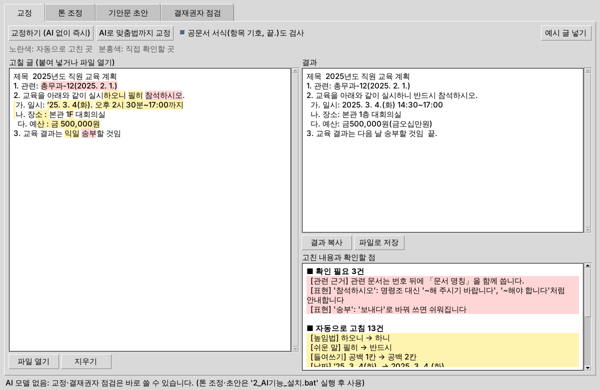

# 공문서 작성 보조 AI (gongmun-ai)

저사양 업무 PC 안에서 **외부 통신 없이, 무료로** 동작하는 행정 문서 작성 도구입니다.

| 기능 | 하는 일 | AI 모델 필요 |
|---|---|---|
| **교정** | 날짜·시각·금액 표기, 항목 기호(1. → 가. → 1) …), 들여쓰기, `끝.` 표시, 띄어쓰기, 어려운 행정 용어 → 쉬운 말 | 필요 없음 (즉시) |
| **AI 교정** | 위 기능에 맞춤법과 어색한 문장 교정을 더함 | 필요 |
| **톤 조정** | 보고서(개조식) / 대외공문 / 쉬운말 / 간결 / 안내문 | 필요 |
| **초안 작성** | 요청과 참고 문서로 **보고서(붙임)** 또는 **기안문** 초안 작성 | 필요 |
| **한글 파일 저장** | 결과를 기관 양식의 `.hwpx`(또는 `.hwp`)로 저장. 보고서는 표지(등록번호·결재란·제목 띠·로고·요약 상자)와 Ⅰ·Ⅱ 장, 머리행 음영 표 | 필요 없음 |
| **학습(지식)** | 보고서·공문(HWP·HWPX·DOCX·PDF·TXT)을 넣으면 내용과 문서 습관(소제목·표 양식·끝맺음)을 배워 초안에 반영. PC마다 쌓이고, 지식 꾸러미로 나눔 | 필요 없음 |
| **결재권자 성향** | 팀장·부서장별 선호(두괄식, 분량, 필수 항목, 금지 표현)를 반영하고 점검 | 점검은 불필요 |

반영된 규칙 전체는 [docs/공문서_작성_규칙.md](docs/공문서_작성_규칙.md)를 참고하세요(「공문서 작성법 길라잡이」(2025. 1. 8.) 기준).

## 설치 없이 쓰기 (윈도우 ZIP)

[Releases](https://github.com/raonabba/local_ai/releases)에서 `공문서AI_윈도우.zip`을 받아 압축을 풀고 `공문서AI.exe`를 실행합니다.
파이썬도 설치할 필요가 없습니다(실행 파일에 파이썬·AI 엔진·HWP 읽기 기능이 들어 있음). 사용법은 압축 안의 `사용설명.txt`를 보세요.
ZIP은 `.github/workflows/windows-zip.yml`이 윈도우에서 만들고 실행 파일을 자체 점검한 뒤 올립니다.

## 바로 써 보기 (윈도우, 소스에서)

1. [Python 3.12](https://www.python.org/downloads/windows/)를 설치합니다. 첫 화면에서 **Add python.exe to PATH**를 체크하세요.
2. **`1_실행.bat`** 을 더블클릭합니다. 인터넷이 없어도 교정과 결재권자 점검을 바로 쓸 수 있습니다.
3. AI 기능(톤 조정, 기안문 초안)을 쓰려면 인터넷이 되는 PC에서 **`2_AI기능_설치.bat`** 을 실행합니다(AI 엔진과 무료 모델 약 2.5GB).



자세한 내용은 `사용설명.txt`를 보세요. 리눅스·맥에서는 `PYTHONPATH=src python3 -m gongmun_ai.gui`로 실행합니다.

## 설계 원칙

- **무료**: 모든 구성 요소가 무료 오픈소스입니다(llama.cpp는 MIT, 권장 모델은 Apache 2.0).
- **저사양**: 규칙으로 할 수 있는 일(표기, 서식)은 AI 없이 처리합니다. AI는 문장을 쓰는 데만 써서 작은 모델로도 충분합니다.
- **서식은 프로그램이 책임**: AI는 내용만 JSON으로 만들고, 항목 기호·붙임·`끝.`은 프로그램이 규칙대로 붙입니다. 모델이 작아도 서식이 깨지지 않습니다.
- **사실 보존 검사**: AI 결과에서 원문의 숫자(날짜·금액·인원)가 바뀌거나 새로 생기면 경고합니다.
- **외부 통신 없음**: 모델을 프로그램 안에서 직접 실행하고(로컬 서버 포트를 열지 않음), 시작할 때 인터넷 연결을 차단합니다.

## 설치

Python 3.11 이상이 필요합니다.

```bash
pip install -e .          # 교정·성향 점검만 (AI 없이)
pip install -e .[llm]     # AI 기능까지 (llama.cpp 포함)
```

## 모델 고르기 (무료)

GGUF 형식의 `Q4_K_M` 양자화 파일을 `models/` 폴더에 넣으면 자동으로 사용합니다.

| PC 메모리 | 모델 크기 | 후보 (모두 상업적 무료 사용 가능) |
|---|---|---|
| 8GB, GPU 없음 | 2~4B (약 1.5~2.5GB) | Kanana 1.5 2.1B, Qwen3 4B, Gemma 3 4B |
| 16GB | 7~8B (약 4.5~5GB) | A.X 4.0 Light, Kanana 1.5 8B |

- 라이선스는 버전마다 바뀔 수 있습니다. 도입 전에 각 모델의 LICENSE를 확인하세요.
- EXAONE은 상업적으로 쓰려면 별도 계약이 필요하고, Llama는 군사 용도를 금지합니다.
- 업무 PC가 인터넷에 연결되지 않으면, 인터넷 PC에서 내려받아 기관의 반입 절차로 옮기세요.

## 사용법

```bash
# 교정 (AI 없이 즉시)
gongmun 교정 문서.txt
gongmun 교정 문서.txt --out 고친문서.txt
gongmun 교정 문서.txt --ai            # 맞춤법까지 AI로

# 톤 조정
gongmun 톤 문서.txt --style 쉬운말 --profile profiles/팀장_예시.toml

# 기안문 초안
gongmun 기안 "작년 결과보고 형식으로 올해 교육 계획" \
    --profile profiles/팀장_예시.toml --ref 작년_결과보고.txt

# 결재권자 기준 점검
gongmun 성향 점검 profiles/부서장_예시.toml 기안.txt
```

`gongmun` 명령이 없으면 `python -m gongmun_ai`로 실행하세요. 영어 명령(`proofread`, `tone`, `draft`, `profile`)도 같습니다.

### 교정 예시

```
입력                                         결과
1. 관련: 총무과-123(2026년 10월 1일.)        1. 관련: 총무과-123(2026. 10. 1.)
2. 금일 오후 2시 30분에 개최하오니 … 요망.  2. 오늘 14:30에 개최하니 … 바람.
 가. 예산: 1,500,000원                         가. 예산: 금1,500,000원(금일백오십만원)
  다. … 상기 내용과 같으며 변경될수 있음.      나. … 위 내용과 같으며 변경될 수 있음.
2. 회의 결과는 익일 송부할 것임              3. 회의 결과는 다음 날 송부할 것임  끝.
```

### 결재권자 성향 파일

`profiles/` 폴더의 예시를 복사해 고쳐 쓰세요.

```toml
name = "김 팀장"
style = "개조식"            # 개조식 | 서술식
conclusion_first = true     # 결론부터(두괄식)
max_chars = 800
required_sections = ["추진 일정", "소요 예산"]
prefer = ["~할 계획임"]
avoid = ["검토 중", "추후 결정"]
notes = "숫자로 말하는 보고를 좋아함"
```

쉬운 말 사전은 `src/gongmun_ai/easy_words.py`, AI에 주는 작성 지침은 `src/gongmun_ai/knowledge.py`에서 기관에 맞게 고칠 수 있습니다.

## 테스트

```bash
PYTHONPATH=src python -m unittest discover -s tests
```

## 학습(지식) 방식

모델 자체를 다시 훈련하지 않고, 넣은 문서를 이 PC의 지식 DB(`지식/지식.db`, SQLite)에 쌓아 두고 찾아 쓰는 방식(RAG)입니다.
저사양 PC에서도 넣는 즉시 반영되고, 문서를 지우면 지식에서도 바로 빠집니다.

- **내용**: 문단 묶음으로 색인합니다(한글 두 글자 단위 검색). 초안을 쓸 때 요청과 관련된 문단을 찾아 AI에 참고 자료로 줍니다.
- **문서 습관**: 자주 쓰는 소제목, 표 머리(열 구성), 문장 끝맺음을 세어 AI 지침에 넣습니다.
- **나누기**: `.gkb` 지식 꾸러미로 내보내고 다른 PC에서 가져오면 합쳐집니다. 같은 문서는 내용으로 걸러 중복되지 않고, 문서마다 출처 PC가 남습니다.

## 다음 단계

1. **실제 모델로 품질 확인**: 목표 PC에서 후보 모델별 속도와 초안 품질 비교
2. **기관 양식 파일 채우기**: 기관이 쓰는 HWPX 양식을 그대로 두고 내용만 채워 넣기
3. **문단별 근거 표시**: 초안 문단마다 참고한 학습 문서 표시
4. **보안 마무리**: 지식 DB 암호화 저장, 이용 기록, 서명된 업데이트
